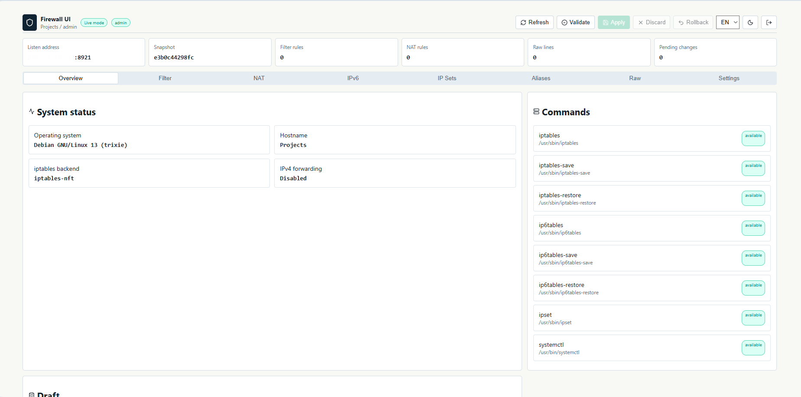
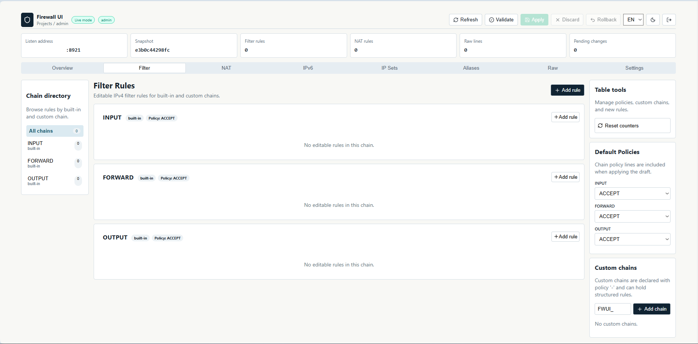
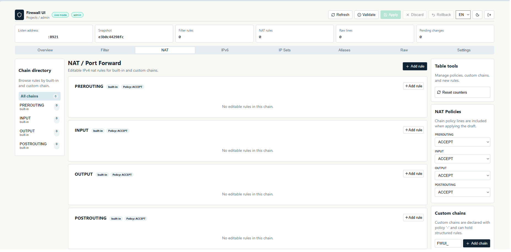
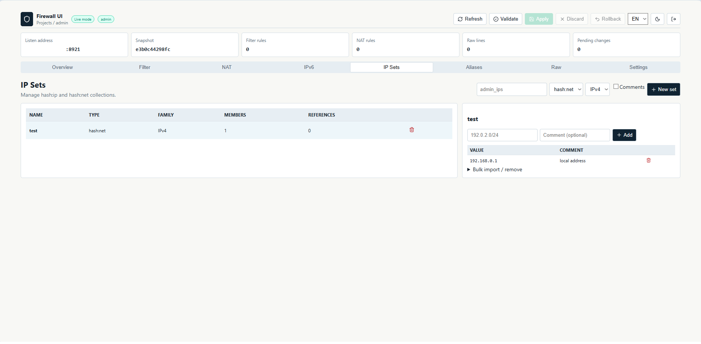
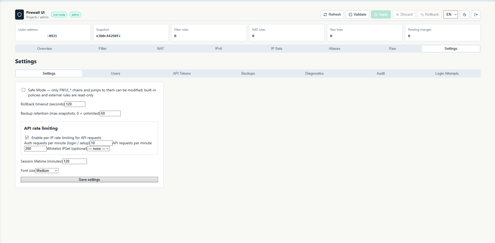

<div align="center">

# firewall-ui

**Standalone web interface for safely managing Linux `iptables`, `ip6tables`, and `ipset`.**

One Go binary · Embedded React UI · SQLite · Safe apply and automatic rollback

[Features](#features) · [Screenshots](#screenshots) · [Installation](#installation) · [Configuration](#configuration) · [REST API](docs/API.md)

</div>

---

## Overview

`firewall-ui` provides a modern browser interface for a single Linux firewall host. The production frontend, HTTP server, authentication, and SQLite storage are bundled into one executable—no PHP, application server, or Node.js runtime is required.

The application imports the live ruleset, keeps edits in a draft, validates it before applying, creates a backup, and starts an automatic rollback timer. Existing unsupported rules from software such as Docker, Proxmox, libvirt, and Kubernetes are preserved as raw rules.

> [!WARNING]
> Firewall changes can interrupt remote access. Keep console or out-of-band access available, review the diff, and confirm connectivity before confirming an applied ruleset.

## Features

- IPv4 and IPv6 filter/NAT rule management
- Draft → validate → diff → apply → confirm workflow
- Timed automatic rollback and firewall backups
- Safe Mode with protected built-in and third-party chains
- Custom `FWUI_*` chains, policies, ordering, counters, and comments
- Source/destination IP, CIDR, IPSet, and alias matches
- TCP/UDP ports and conntrack states
- DNAT, SNAT, and MASQUERADE rules
- IPSet IPv4/IPv6 families, `hash:ip`, `hash:net`, comments, and bulk operations
- Users with `admin`, `operator`, and `viewer` roles
- API tokens, CSRF protection, configurable rate limits, and IPSet whitelist
- Brute-force protection with login attempt monitoring
- Audit log with before/after data
- English, Russian, and Ukrainian interface
- Embedded SQLite database and React frontend
- REST API for automation

## Screenshots

### Dashboard



<details>
<summary><strong>Filter rules</strong></summary>



</details>

<details>
<summary><strong>NAT rules</strong></summary>



</details>

<details>
<summary><strong>IP Sets</strong></summary>



</details>

<details>
<summary><strong>Settings</strong></summary>



</details>

## Requirements

### Runtime

The application is distributed as one binary, but uses the host firewall tools:

- Linux
- `iptables`, `iptables-save`, `iptables-restore`
- `ip6tables`, `ip6tables-save`, `ip6tables-restore` for IPv6
- `ipset`
- `systemd`/`systemctl` when using the built-in installer

SQLite is embedded. Node.js, npm, Nginx, Apache, and PHP are **not** runtime dependencies.

Install firewall tools on Debian/Ubuntu:

```bash
sudo apt update
sudo apt install iptables ipset
```

Install them on RHEL/CentOS/Rocky Linux/AlmaLinux/Fedora:

```bash
sudo dnf install iptables ipset
```

### Build

- Go 1.22 or newer
- Node.js and npm

## Installation

### Install a downloaded binary

```bash
chmod +x firewall-ui
sudo ./firewall-ui install
```

The installer:

1. checks required host commands;
2. copies the binary to `/usr/local/bin/firewall-ui`;
3. creates configuration, data, backup, and log directories;
4. writes `/etc/firewall-ui/config.yaml` if it does not exist;
5. installs and starts `firewall-ui.service`.

> [!IMPORTANT]
> Installation does **not** create, remove, or modify `iptables`, `ip6tables`, or `ipset` rules. It also does not open TCP port `8921`.

Open the interface at:

```text
http://SERVER_IP:8921
```

On first launch, create the administrator account in the setup screen.

### Build from source

```bash
make build
sudo ./build/firewall-ui install
```

The resulting standalone executable is written to `build/firewall-ui`.

## Development

```bash
make dev      # build and start on 0.0.0.0:8921
make build    # build frontend and standalone binary
make test     # build frontend and run Go tests
make clean    # remove generated build output
```

To run directly without installing a service:

```bash
./build/firewall-ui --listen 0.0.0.0:8921
```

## Configuration

Default path: `/etc/firewall-ui/config.yaml`

```yaml
server:
  listen: "0.0.0.0:8921"

firewall:
  backend: "iptables"
  mode: "safe"
  rollback_timeout: 120

storage:
  database: "/var/lib/firewall-ui/firewall.db"
  backups: "/var/lib/firewall-ui/backups"

auth:
  enabled: true

tls:
  enabled: false
  cert: ""
  key: ""
```

Supported environment overrides include:

```bash
FWUI_LISTEN=127.0.0.1:8921
FWUI_DATABASE=/var/lib/firewall-ui/firewall.db
FWUI_BACKUPS=/var/lib/firewall-ui/backups
FWUI_ROLLBACK_TIMEOUT=120
```

Command-line values override configuration-file values.

## Reverse proxy and HTTPS

The built-in server currently listens over HTTP. For production, bind it to localhost and place Nginx or another trusted reverse proxy in front of it:

```yaml
server:
  listen: "127.0.0.1:8921"
```

Terminate TLS at the reverse proxy and restrict direct network access to port `8921`. The application does not automatically configure Nginx, certificates, or firewall rules.

## REST API

The browser interface is backed by a versioned JSON API under `/api/v1`. It supports browser sessions and bearer API tokens.

```bash
export FWUI_URL="http://127.0.0.1:8921"
export FWUI_TOKEN="fw_REPLACE_ME"

curl -sS \
  -H "Authorization: Bearer $FWUI_TOKEN" \
  "$FWUI_URL/api/v1/system"
```

See **[REST API documentation](docs/API.md)** for authentication, roles, scopes, every endpoint, request models, error responses, IPSet examples, and the safe apply workflow.

## CLI commands

```bash
firewall-ui install     # install and start the systemd service
firewall-ui uninstall   # stop and remove service and binary
firewall-ui status      # display installation/service state
firewall-ui version     # print version information
```

## Runtime paths

| Purpose | Path |
|---|---|
| Binary | `/usr/local/bin/firewall-ui` |
| Configuration | `/etc/firewall-ui/config.yaml` |
| SQLite database | `/var/lib/firewall-ui/firewall.db` |
| Firewall backups | `/var/lib/firewall-ui/backups` |
| Logs directory | `/var/log/firewall-ui` |
| systemd unit | `/etc/systemd/system/firewall-ui.service` |

## Security model

- Passwords are hashed with bcrypt.
- Browser sessions use HttpOnly, SameSite cookies and CSRF tokens.
- API tokens are stored as hashes and shown only once at creation.
- Login brute-force protection and configurable API rate limiting are enabled.
- The systemd unit uses `CAP_NET_ADMIN` and `CAP_NET_RAW` instead of unrestricted service capabilities.
- Safe Mode limits managed changes to `FWUI_*` chains and jumps to them.
- Unsupported third-party rules remain visible and are preserved.

## Scope

`firewall-ui` manages one firewall host per installation. Multi-server orchestration, native TLS termination, and `.deb`/`.rpm` packages are intentionally outside the current scope.
